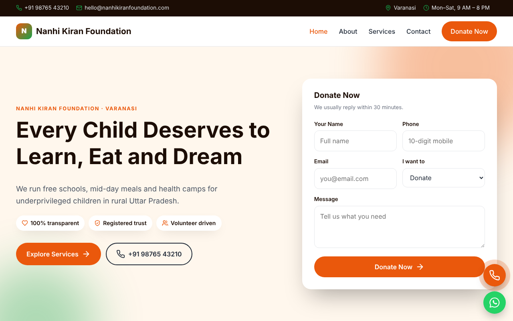
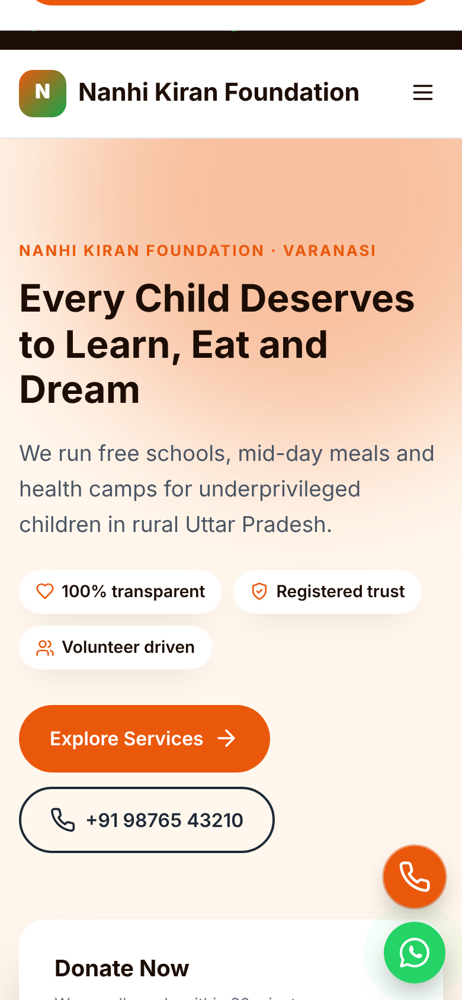

# Nanhi Kiran – Free NGO & Charity Website Template (HTML/CSS)

A free, responsive website template for NGOs, charitable trusts, foundations and community organisations. Plain HTML5, CSS3 and a few lines of vanilla JavaScript: no build tools, no framework and no page builder. It runs on any static host or ordinary shared hosting.

**Live demo:** https://webtemplatehub.online/demo/nanhi-kiran-foundation-ngo-template/
**Full package and other templates:** https://webtemplatehub.online/template/nanhi-kiran-foundation-ngo-template/

## What's included

- 4 pages: `index.html`, `about.html`, `services.html`, `contact.html`
- Sections on the home page: Split hero with enquiry form, impact stats band, what we offer, how it works, ways to give, photo section, testimonials, FAQ and a final call to action; the contact form lets visitors choose Donate, Volunteer, Partner (CSR) or Other
- Mobile-first responsive layout with a mobile menu
- Click-to-call and WhatsApp buttons
- Enquiry form markup ready to connect
- One stylesheet (`assets/css/style.css`) and one small script (`assets/js/main.js`)
- Google Fonts loaded in the `<head>` of each page

## The contact form

This GitHub copy does not send emails. The form shows a message on submit and nothing is stored or sent.

To receive enquiries by email you have two options:

1. Download the free full package from [Web Template Hub](https://webtemplatehub.online/template/nanhi-kiran-foundation-ngo-template/). It adds the `contact.php` mail handler. Set your email address in it and upload it with the other files to PHP hosting.
2. Point the form's `action` at a form service of your choice and remove the `data-demo` attribute from the `<form>` tag.

## Quick start

1. Click **Code → Download ZIP**, or clone the repository.
2. Open `index.html` in your browser to preview it.
3. Edit the text in the four HTML files with a code editor such as VS Code.
4. Use search across all files to replace the demo business name, phone number, WhatsApp number, email and address.
5. Change the brand colours in the CSS variables at the top of `assets/css/style.css`.
6. Update the `<title>`, meta description and Open Graph tags on every page. Replace `www.example.com` with your domain.
7. Upload the files to your hosting, or publish them free with GitHub Pages (**Settings → Pages → Deploy from branch → main**).

More setup guides: [Web Template Hub blog](https://webtemplatehub.online/blog/)

## Need it set up for you?

Our partner agency can install, brand and launch this template on your domain. See [custom website design](https://webtemplatehub.online/custom-website-design/).

More templates for Indian businesses: [webtemplatehub.online/templates](https://webtemplatehub.online/templates/)

## Licence

Free to use for your own or client websites. Reselling or redistributing it as a template is not allowed. See [LICENSE.txt](LICENSE.txt).
